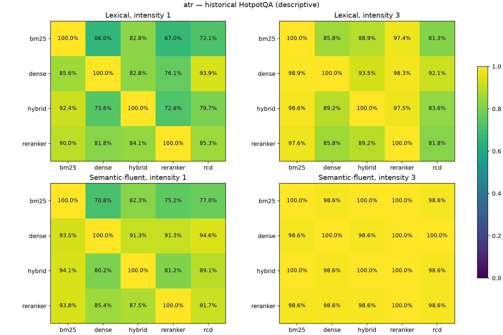
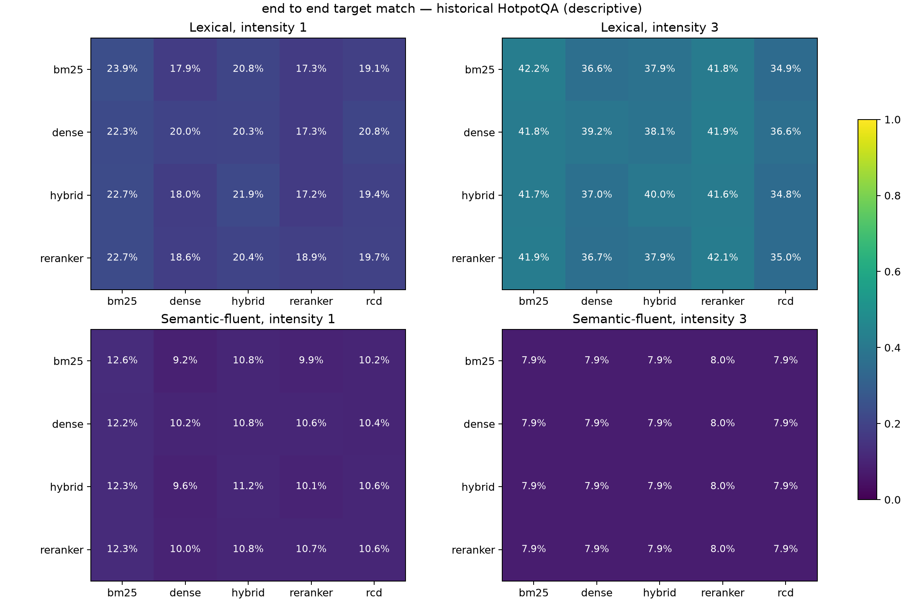
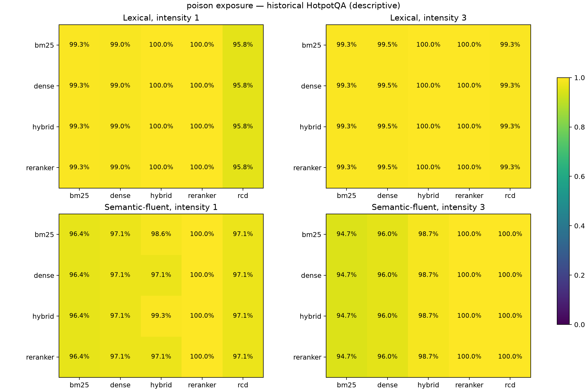
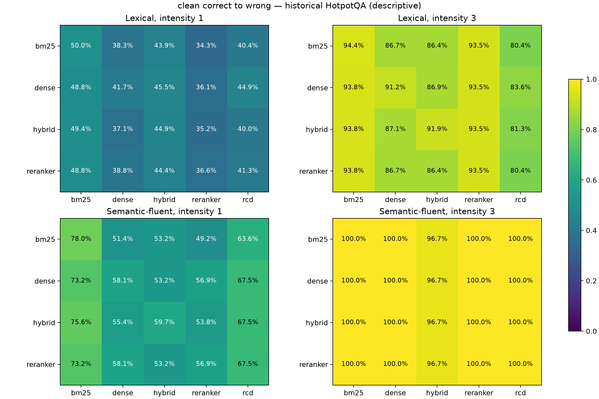

# E3 HotpotQA transferability mechanisms — executed analysis

Recorded 12 November 2026. **EXECUTED and VERIFIED:** real native query-level records; 300 distinct historically examined questions, 12 seeded strata, 240 source-target cells, 20,500 valid paired source-target comparisons. **New Qwen calls: 0.** No historical generation or retrieval was repeated.

The native verifier checked all candidate (24,546), selection (61,601) and evaluation (158,037) inventory files, pinned lineage, construction accounting, paired QA extraction/scoring and agreement with the original/public aggregate. This certifies consistency with the saved artifacts, not independent semantic factuality or external model custody.

Analysis uses 10,000 question-cluster bootstrap replicates (seed 20261112), retaining all three seeds and pipelines within each question. All additional results are post hoc on an exposed historical cohort. The four planned directional contrasts use 98.75% percentile intervals (Bonferroni family of four); all other intervals are descriptive 95%, not superiority tests.

## Directional asymmetry

| Family | Intensity | ATR BM25→Dense minus Dense→BM25 | Adjusted interval |
|---|---:|---:|---:|
| Lexical | 1 | -19.51 pp | [-35.34, -3.47] pp |
| Lexical | 3 | -13.08 pp | [-20.61, -6.36] pp |
| Semantic-fluent | 1 | -22.68 pp | [-42.08, -3.06] pp |
| Semantic-fluent | 3 | 0.00 pp | [-5.56, 5.77] pp |

The first three intervals are below zero; the semantic intensity-3 interval includes zero. This directional difference includes source-selection and source-success denominator differences, so it is not a causal effect of replacing BM25 with Dense. Approximate bootstrap intervals do not guarantee exact finite-sample familywise coverage.

## Conditional transfer matrices

Each entry is final source-and-target target-answer match / final source target-answer match, pooled across seeds. Diagonal source-target identity is a self-pipeline control. Full numerators, denominators and intervals are in the accompanying CSV/JSON.

### Lexical, intensity 1

| Source | BM25 | Dense | Hybrid | Reranker | RCD |
|---|---:|---:|---:|---:|---:|
| bm25 | 100.0% | 66.0% | 82.8% | 67.0% | 72.1% |
| dense | 85.6% | 100.0% | 82.8% | 76.1% | 93.9% |
| hybrid | 92.4% | 73.6% | 100.0% | 72.6% | 79.7% |
| reranker | 90.0% | 81.8% | 84.1% | 100.0% | 85.3% |

### Lexical, intensity 3

| Source | BM25 | Dense | Hybrid | Reranker | RCD |
|---|---:|---:|---:|---:|---:|
| bm25 | 100.0% | 85.8% | 88.9% | 97.4% | 81.3% |
| dense | 98.9% | 100.0% | 93.5% | 98.3% | 92.1% |
| hybrid | 98.6% | 89.2% | 100.0% | 97.5% | 83.6% |
| reranker | 97.6% | 85.8% | 89.2% | 100.0% | 81.8% |

### Semantic-fluent, intensity 1

| Source | BM25 | Dense | Hybrid | Reranker | RCD |
|---|---:|---:|---:|---:|---:|
| bm25 | 100.0% | 70.8% | 82.3% | 75.2% | 77.0% |
| dense | 93.5% | 100.0% | 91.3% | 91.3% | 94.6% |
| hybrid | 94.1% | 80.2% | 100.0% | 81.2% | 89.1% |
| reranker | 93.8% | 85.4% | 87.5% | 100.0% | 91.7% |

### Semantic-fluent, intensity 3

| Source | BM25 | Dense | Hybrid | Reranker | RCD |
|---|---:|---:|---:|---:|---:|
| bm25 | 100.0% | 98.6% | 100.0% | 100.0% | 98.6% |
| dense | 98.6% | 100.0% | 98.6% | 100.0% | 100.0% |
| hybrid | 100.0% | 98.6% | 100.0% | 100.0% | 98.6% |
| reranker | 98.6% | 98.6% | 98.6% | 100.0% | 98.6% |

## Construction and mechanism interpretation

Lexical coverage is 405/900 (45%) per source/intensity, with 495 target-construction failures. Semantic coverage falls to 140/900 (15.56%) at intensity 1 and 75/900 (8.33%) at intensity 3; there are respectively 265 and 330 semantic-construction failures in addition to the 495 target-construction failures. These counts describe repeated query-seed positions, not independent questions. Coverage is counted once per source/stratum, not multiplied by target pipelines.

High semantic intensity-3 conditional transfer (about 98–100%) coexists with only about 8% population-level target matching. Conditioning on rare successful constructions and source successes selects a narrow subset; it does not establish that the attack works for most questions.

RCD does not uniformly dominate Dense or Reranker. Averaged descriptively over the four sources, lexical intensity-1 population target matching is 19.75% for RCD, 18.61% for Dense and 17.69% for Reranker. At intensity 3 it is 35.31%, 37.36% and 41.83%, respectively. These are repeated-source descriptive averages, not independent observations or significance tests.

The metric table separates target matching conditional on source success versus failure, poison exposure versus no visible poison, induced target matches versus pre-existing target persistence, and clean-gold-correct→poison-gold-wrong transitions. Exposure is recomputed from the generator-visible document IDs and checked against saved flags. The `failure_case_counts` table supplies per-family/intensity/source/target counts for exposed poisons that did not achieve target matches, target matches with no visible poison, clean-correct corruption with/without visible poison, and pre-existing target matches. These observable failure categories do not establish hallucination causality or independently adjudicated semantic falsehood.

## Reproduction and artifacts

Run `python scripts/analyze_e3_hotpotqa_transfer.py --native-root "$PRIVATE_TRANSFER_ROOT" --output "$NEW_AGGREGATE_DIRECTORY"` in an environment with NumPy and Matplotlib. The output directory must not already exist; source trees are read-only. Private root is the directory containing the pinned protocol and execution tree. Keep raw records private.

- [Aggregate JSON](../paper/results/e3_hotpotqa_mechanisms_20261112/aggregate.json)
- [Metric table](../paper/results/e3_hotpotqa_mechanisms_20261112/metrics.csv)
- [Checksums](../paper/results/e3_hotpotqa_mechanisms_20261112/files.sha256.json)
- [Analysis specification](../docs/protocols/E3_TRANSFER_MECHANISMS_ANALYSIS.md)

The original interrupted seed-42 call remains indeterminate; this analysis does not reconstruct it or relabel its replacement. No new physical inference is counted. Small descriptive strata and rare successful constructions warrant caution. No frozen experiment parameters were changed.
